# Jefferson Super Reader 3000 — Multimodal Document Intelligence & RSVP Streaming Pipeline

> **Architecture:** CloudConvert Asynchronous Conversion Pipeline + Gemini Vision OCR Extraction + Zero-Lag ORP Client Renderer  

## 1. Executive Summary & Problem Statement
Standard PDF and document parsers strip semantic context or fail on complex multi-column layouts, tables, and scanned page images—breaking Rapid Serial Visual Presentation (RSVP) speed-reading flows with garbled tokens and header/footer noise.

**Jefferson Super Reader 3000** replaces brittle text-layer scraping with a **multimodal document ingestion pipeline** combining **CloudConvert file normalization** and **Gemini Vision OCR extraction** to stream clean, layout-aware token sequences into an **Optimal Recognition Point (ORP)** speed-reading engine.

---

## 2. System Architecture & Infrastructure Topology

```mermaid
graph LR
    subgraph Ingestion_Layer ["Multi-Format Document Ingestion"]
        Upload["Document Upload (PDF / EPUB / DOCX / Scans)"]
        CC["CloudConvert Async Job Pipeline"]
        Frames["Normalized Page Image Frames"]
    end

    subgraph Vision_Layer ["Multimodal AI Extraction"]
        GV["Gemini Vision API"]
        Clean["Semantic Layout & Noise Filter"]
        Stream["Normalized Token Stream"]
    end

    subgraph Client_Engine ["Zero-Lag RSVP Viewport"]
        ORP["Optimal Recognition Point (ORP) Aligner"]
        Cadence["Dynamic WPM & Punctuation Cadence Controller"]
    end

    Upload --> CC
    CC --> Frames
    Frames --> GV
    GV --> Clean
    Clean --> Stream
    Stream --> ORP
    ORP --> Cadence
```



---

## 3. Key Engineering Decisions & Production Highlights

### Asynchronous Multi-Format Normalization (`CloudConvert API`)
* Engineered a non-blocking conversion pipeline that transforms arbitrary source files (scanned PDFs, DOCX, slide decks) into uniform, high-contrast page frames prior to vision inference.

### Layout-Aware Multimodal Extraction (`Gemini Vision`)
* Replaced regex-based PDF text extraction with **Gemini Vision**, preserving true human reading order across multi-column layouts while stripping running headers, footers, page numbers, and citation clutter.

### Deterministic Optimal Recognition Point (ORP) Rendering Engine
* Built a zero-lag client-side RSVP scheduler that calculates the **Optimal Recognition Point (ORP)** anchor character for every word length and dynamically modulates frame duration around punctuation boundaries and clause breaks.

---

## 4. Repository Structure

```text
jefferson-super-reader-3000/
├── src/
│   ├── components/
│   │   ├── ReaderViewport/     # ORP-aligned RSVP display & focal reticle
│   │   ├── UploadPipeline/     # Document ingestion & CloudConvert status tracker
│   │   └── CadenceControls/    # WPM, chunk size & punctuation pause controls
│   ├── services/
│   │   ├── cloudConvert.ts     # Asynchronous file-to-frame job orchestration
│   │   ├── geminiVision.ts     # Multimodal OCR prompt & layout normalization
│   │   └── tokenizer.ts        # ORP index calculation & punctuation weighting
│   └── App.tsx                 # Application state & reading session persistence
├── api/                        # Serverless proxy routes for API key isolation
└── package.json                # Dependencies & build scripts
```

---

## 5. Local Development & Verification

```bash
# 1. Install dependencies
npm install

# 2. Configure environment variables (.env.local)
# GEMINI_API_KEY=...
# CLOUDCONVERT_API_KEY=...

# 3. Start development server
npm run dev

# 4. Build production bundle
npm run build
```
